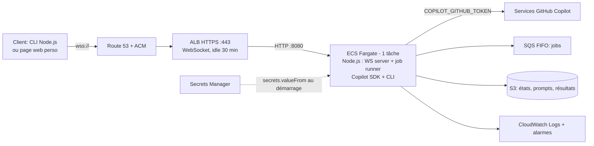
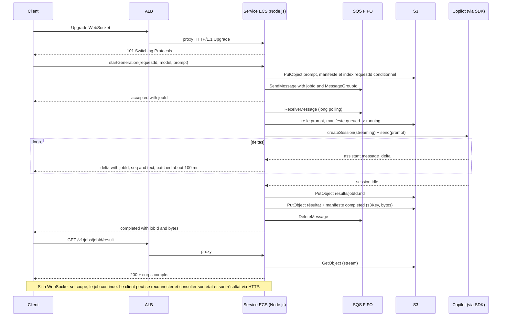

# Analyse — Gateway LLM personnelle sur AWS : ALB + ECS Fargate + GitHub Copilot SDK

**Date :** 9 octobre 2026  
**Périmètre :** API personnelle hébergée sur AWS qui exécute des requêtes via le GitHub Copilot SDK, pour des réponses potentiellement longues (plusieurs minutes, parfois plus) et volumineuses (plusieurs Mo).  
**Versions précédentes :** [ANALYSE_v1_generique.md](ANALYSE_v1_generique.md) (multi-options) et [ANALYSE_v2_serverless.md](ANALYSE_v2_serverless.md) (API Gateway WebSocket + Lambda + SQS), conservées pour référence.

## Contraintes de départ

| Contrainte | Conséquence sur la conception |
|---|---|
| Projet personnel, un seul utilisateur (moi) | Pas de multi-tenant; pas d'authentification applicative en V1; accès réseau limité à mon IP publique. |
| **Copilot SDK non négociable** (seule licence disponible) | Le runtime Copilot CLI tourne dans le conteneur, de façon persistante. Pas de BYOK, pas de fournisseur direct. Le token reste côté serveur. |
| Réponses longues (minutes, voire dizaines de minutes) | Pas de Lambda (15 min max), pas d'API Gateway (29–30 s par intégration, 2 h par connexion). Un service persistant qui tient la connexion WebSocket lui-même. |
| Réponses volumineuses | Plus de plafond de 128 Ko par message : les deltas passent directement sur la WebSocket. Le résultat complet est quand même persisté dans S3 pour être récupérable après coupure. |
| Pas de dépendance à un poste allumé | Service ECS Fargate toujours actif dans AWS. |

## Synthèse

**Architecture retenue :** un **Application Load Balancer** (HTTPS, WebSocket natif) devant un **service ECS Fargate à une tâche** qui fait trois choses dans le même processus Node.js : serveur WebSocket/HTTP, consommateur SQS et hôte du runtime Copilot SDK/CLI. **SQS FIFO** transporte les jobs; **S3** conserve les manifests d'état, les prompts temporaires et les résultats; **Secrets Manager** conserve le token Copilot. Ni API Gateway, ni Lambda, ni DynamoDB.

**Ce qu'on gagne :** plus aucune limite de durée imposée par la plateforme (le job dure ce qu'il doit durer), plus de limite de taille de message, un seul runtime Copilot démarré une fois et réutilisé (pas de cold start CLI à chaque job), un code unique et simple à déboguer.

**Ce qu'on paie :** un coût fixe au repos (ALB + Fargate + IPv4 publiques), de l'ordre de **40 à 50 €/mois**, là où la version serverless était quasi gratuite au repos. Et un service à redéployer proprement : un déploiement pendant un job long interrompt ce job (Fargate laisse au plus 120 s pour s'arrêter).

**Identité et licence :** usage strictement personnel, sous ma propre identité Copilot, pour mes propres requêtes. Le token n'est jamais exposé au client ni journalisé; l'API n'est ouverte à personne d'autre. Chaque job consomme un prompt de mon quota Copilot.

## Ce que fait réellement le Copilot SDK (et ce que ça impose)

Le [Copilot SDK](https://github.com/github/copilot-sdk) est un client JSON-RPC vers le **Copilot CLI en mode serveur**; le SDK Node.js embarque le CLI et gère son processus. Dans un conteneur persistant, c'est le cas d'usage le plus naturel :

- **Un seul `CopilotClient` pour la vie du processus** : spawn du CLI au démarrage, `client.stop()` à l'arrêt (SIGTERM). Si le CLI meurt, le watchdog le relance et le health check passe en 503 le temps du redémarrage.
- **Une session par job** : `createSession({ model, streaming: true, sessionId: jobId })`, puis `deleteSession` à la fin. `sessionIdleTimeoutSeconds` en filet de sécurité pour les sessions orphelines.
- **`mode: "empty"`** même en mono-utilisateur : le mode `copilot-cli` par défaut expose shell et fichiers du conteneur. L'API ne doit jamais pouvoir exécuter de commande.
- **`baseDirectory`** sur le stockage éphémère de la tâche. L'état de session n'a pas besoin de survivre à la tâche : la vérité métier est dans S3 et les jobs en attente sont dans SQS.
- **Streaming :** `session.on("assistant.message_delta", …)` pour les deltas, `session.idle` pour la fin.
- **Authentification :** `COPILOT_GITHUB_TOKEN` injecté par ECS depuis Secrets Manager (`secrets.valueFrom`). Tokens acceptés : `github_pat_` (fine-grained), `gho_`, `ghu_`; pas de `ghp_`. `useLoggedInUser: false`.
- **Facturation :** un prompt par job sur mon quota Copilot; le quota est suivi côté GitHub, sans compteur quotidien transactionnel dans cette V1.

## Pourquoi ALB + ECS plutôt que les variantes précédentes

| Approche | Verdict |
|---|---|
| API Gateway HTTP API → Lambda | 30 s par intégration : exclu. |
| API Gateway WebSocket + Lambda + SQS (v2) | Fonctionne, coût nul au repos, mais : 29 s par route, 2 h par connexion, 128 Ko par message, 15 min par job Lambda, CLI Copilot relancé à chaque invocation, et incertitude sur le CLI dans Lambda. Beaucoup de pièces pour contourner des limites qu'un service persistant n'a pas. |
| **ALB + ECS Fargate (retenu)** | WebSocket natif, idle timeout configurable, pas de limite de durée ni de taille, runtime Copilot persistant, un seul composant applicatif. Coût fixe mensuel. |
| ECS sans ALB (IP publique de la tâche + certificat dans le conteneur) | Économise ~20 €/mois mais : IP qui change à chaque redéploiement, TLS à gérer soi-même, pas de health check externe, pas de WAF possible. Acceptable pour un bricolage, pas pour quelque chose qu'on veut laisser tourner. |
| NLB au lieu d'ALB | Moins cher à l'heure, TLS passthrough ou terminaison, mais pas de routage HTTP ni de WAF. L'ALB apporte plus pour quelques euros de différence. |

## Architecture cible



### Déroulé d'un job



### Composants et réglages

**Route 53 + ACM**
- Un nom de domaine (ou sous-domaine) obligatoire : l'ALB n'a pas de certificat par défaut. Certificat ACM gratuit, enregistrement alias vers l'ALB.

**ALB**
- Listener HTTPS 443 (TLS 1.2+, politique récente), redirection 80 → 443. Target group HTTP 8080, health check `GET /health` toutes les 30 s.
- `idle_timeout.timeout_seconds` : 60 s par défaut, à monter (par exemple 1 800 s). Le service envoie un ping WebSocket toutes les 30 s : le trafic maintient la connexion même sous le délai par défaut.
- Security group : entrée 443 uniquement depuis mon IP publique (CIDR `/32` en IPv4 ou `/128` en IPv6), sortie vers le SG de la tâche uniquement. Ne pas utiliser `0.0.0.0/0` ni `::/0`; mettre à jour la règle si mon IP change.
- Optionnel : AWS WAF avec un rate limit par IP. Il ne remplace pas une authentification; l'accès réseau reste limité par le security group.

**Service ECS Fargate**
- Cluster Fargate, 1 service, `desiredCount: 1`, 0,5 vCPU / 1 Go (ARM64/Graviton ≈ 20 % moins cher; vérifier que le binaire Copilot CLI bundlé existe pour `linux/arm64`, sinon x86_64).
- Tâche dans des **subnets publics avec IP publique** (`assignPublicIp: ENABLED`) pour l'egress vers GitHub sans NAT Gateway (≈ 30 €/mois économisés). Security group de la tâche : entrée 8080 depuis le SG de l'ALB uniquement, sortie 443 vers Internet.
- Image : `node:22-slim` + `@github/copilot-sdk` + application. Stockage éphémère Fargate, `COPILOT_HOME=/tmp/copilot-home`.
- Secrets : `COPILOT_GITHUB_TOKEN` via `secrets[].valueFrom` → Secrets Manager. Le rôle d'exécution lit le secret; le rôle de tâche ne l'a pas.
- Déploiement : `minimumHealthyPercent: 100`, `maximumPercent: 200` (la nouvelle tâche est saine avant l'arrêt de l'ancienne), `deregistration_delay` 30 s, `stopTimeout: 120` (maximum Fargate). Circuit breaker de déploiement activé avec rollback.
- Logs : awslogs vers CloudWatch, rétention 30 jours, aucun prompt ni réponse dans les logs.

**Application Node.js (un seul processus)**
- **Serveur HTTP** (`/health`, `/v1/jobs/{id}`, `/v1/jobs/{id}/result`, `/v1/models`) et **serveur WebSocket** (`ws`) sur le même port 8080.
- **Accès client V1** : aucune authentification applicative ni JWT. La restriction d'accès est appliquée au niveau réseau par le security group de l'ALB, limité à mon IP publique.
- **Job runner** : long polling SQS FIFO, un seul `MessageGroupId` pour sérialiser les jobs et une concurrence effective de 1. La visibilité du message est renouvelée pendant l'exécution. L'état est écrit dans `jobs/{jobId}.json` sur S3 à chaque transition; le prompt temporaire est dans `inputs/{jobId}.json` et le résultat dans `results/{jobId}.md`.
- **Deltas** : regroupés toutes les ~100 ms ou 4 Ko, numérotés `seq`; aussi accumulés en mémoire puis écrits dans S3 à la fin (ou par morceaux via multipart upload si la réponse dépasse quelques dizaines de Mo). Si la WebSocket est fermée, le job continue sans émettre.
- **Résultat** : `GET /v1/jobs/{id}/result` streame l'objet S3; l'accès est limité par le security group de l'ALB. Pas d'URL pré-signée exposée.
- **Garde-fous** : taille du prompt plafonnée (200 Ko), allowlist de modèles, durée et taille de sortie maximales configurables. Pas de compteur journalier transactionnel en V1; suivre le quota Copilot et configurer un budget/une alarme AWS.
- **Arrêt propre (SIGTERM)** : refuser les nouvelles actions, prévenir les clients (`shutdown`), interrompre les sessions et attendre les jobs actifs au plus 100 s. Les jobs qui terminent leur nettoyage pendant ce délai écrivent leur résultat partiel et le statut `interrupted`; les jobs qui dépassent le délai seront marqués `interrupted` si leur message SQS est relivré après remplacement de la tâche.
- **Watchdog Copilot** : si `createSession` échoue N fois ou si le processus CLI est mort, recréer le `CopilotClient`; si ça échoue encore, `/health` renvoie 503 et ECS remplace la tâche.

**SQS FIFO + manifests S3**
- La file FIFO transporte uniquement le `jobId`, utilise un groupe unique pour préserver l'ordre et conserve les messages jusqu'à 14 jours. Une DLQ reçoit les messages après plusieurs échecs de livraison.
- Le manifeste `jobs/{jobId}.json` permet à `GET /v1/jobs/{id}` de restituer l'état sans base de données; le prompt est dans `inputs/`, le résultat dans `results/`.
- L'index `requests/{requestId}.json` est créé avec `If-None-Match: *` pour rendre les répétitions du même `requestId` idempotentes. La déduplication native SQS FIFO ne couvre que sa fenêtre de 5 minutes; l'index S3 est conservé 30 jours.
- Si un worker tombe après le passage à `running`, le message redevient visible. Le worker suivant détecte cet état et marque le job `interrupted` plutôt que de lancer une deuxième génération.

**S3**
- Bucket privé, SSE-S3, `results/{jobId}.md`, lifecycle 30 jours, Block Public Access. Accès uniquement via le rôle de tâche.

### Contrat de messages

```json
// client -> serveur (WebSocket)
{"action":"startGeneration","requestId":"7f3a…","model":"gpt-5.4","prompt":"…"}
{"action":"getJob","jobId":"job_01J…"}
{"action":"cancelJob","jobId":"job_01J…"}

// serveur -> client (WebSocket)
{"type":"accepted","requestId":"7f3a…","jobId":"job_01J…"}
{"type":"delta","jobId":"job_01J…","seq":12,"text":"…"}
{"type":"completed","jobId":"job_01J…","bytes":348211}
{"type":"job","jobId":"job_01J…","status":"running","bytesSoFar":120000}
{"type":"failed","jobId":"job_01J…","error":"model_not_allowed|quota_exceeded|upstream_error|timeout"}
{"type":"shutdown","reason":"deploy","graceSeconds":100}
```

HTTP (depuis une IP autorisée) : `GET /health`, `GET /v1/models`, `GET /v1/jobs/{id}` (même payload que `job`), `GET /v1/jobs/{id}/result` (corps complet, `Content-Type: text/markdown`).

`cancelJob` est best-effort : le runner arrête la session entre deux lots de deltas et marque `cancelled`; le texte déjà produit est conservé dans S3.

## Sécurité minimale (même pour un projet perso)

1. **Token Copilot** : Secrets Manager → variable d'environnement injectée par ECS au démarrage. Jamais dans l'image, jamais dans la définition de tâche en clair, jamais dans les logs. Rotation : créer le nouveau PAT, mettre à jour le secret, forcer un nouveau déploiement, révoquer l'ancien.
2. **Accès client V1** : pas de JWT, de Cognito ni d'authentification applicative. Restreindre l'entrée 443 du security group ALB à mon IP publique exacte. Ne jamais ouvrir l'ALB à `0.0.0.0/0` ou `::/0`; en cas d'IP dynamique, mettre à jour la règle ou ajouter ultérieurement une autre barrière d'accès avant toute ouverture publique.
3. **Réseau** : la tâche n'accepte que le SG de l'ALB sur 8080; l'ALB n'accepte que 443 depuis l'IP autorisée. Pas de SSH, pas d'ECS Exec en production (ou activé ponctuellement puis désactivé).
4. **IAM** : rôle de tâche limité aux actions SQS nécessaires sur les deux files et à `s3:GetObject/PutObject/DeleteObject` dans le bucket du projet. Rôle d'exécution : ECR pull, logs, `secretsmanager:GetSecretValue` sur le seul secret.
5. **Copilot SDK** : `mode: "empty"`, aucun outil, aucun MCP, aucun répertoire exposé; le conteneur tourne en utilisateur non-root, système de fichiers en lecture seule sauf `COPILOT_HOME` et `/tmp`.
6. **Données** : S3 chiffré et privé, expiration des prompts temporaires après 1 jour et des jobs/résultats après 30 jours, rétention des logs, aucun contenu de prompt/réponse journalisé.
7. **Garde-fous de coût/quota** : concurrence 1, durée et taille de sortie maximales configurables, alarmes CloudWatch à compléter (tâche non saine, 5xx ALB, CPU/mémoire, jobs `interrupted`/`failed`) et budget AWS mensuel. Aucun compteur quotidien de jobs n'est implémenté en V1.

## Déploiement et exploitation

- **Infra as code** : Terraform : réseau (VPC 2 AZ, subnets publics), ALB + ACM + Route 53, ECS/ECR, SQS FIFO + DLQ, S3, Secrets Manager (valeur renseignée hors Terraform), alarmes.
- **Image** : build local ou GitHub Actions → ECR. Tag immuable par commit.
- **Déployer sans casser un job** : le script de déploiement met à jour le service ECS; SIGTERM attend les jobs jusqu'à 100 s. Un job qui dépasse cette fenêtre peut être interrompu sans résultat partiel; lors de la relivraison SQS, son manifeste devient `interrupted` et le client peut le resoumettre avec un nouveau `requestId`.
- **Observabilité** : métriques applicatives dans CloudWatch (jobs/jour, durée, octets, erreurs par type) via EMF ou `PutMetricData`; tableau de bord minimal.
- **Reprise après incident** : les messages non supprimés redeviennent visibles après expiration de leur délai de visibilité. Si leur manifeste était `running`, le worker le marque `interrupted` sans relancer une génération potentiellement facturée; les tâches `queued` peuvent être réessayées.

## Ordre de grandeur des coûts (eu-west-1 / us-west-2, usage perso)

| Poste | Estimation mensuelle |
|---|---|
| ALB (heures + LCU minimes) | ≈ 17–20 € |
| Fargate 0,5 vCPU / 1 Go, 24/7 (x86_64; ARM ≈ −20 %) | ≈ 15–18 € |
| Adresses IPv4 publiques (2 pour l'ALB + 1 pour la tâche) | ≈ 10–11 € |
| Route 53 zone hébergée | ≈ 0,50 € |
| Secrets Manager (1 secret) | ≈ 0,40 € |
| SQS FIFO, S3, CloudWatch | < 1 € |
| **Total au repos** | **≈ 45–50 €/mois** |

Leviers si c'est trop : Fargate Spot (interruptions possibles → jobs `interrupted`), arrêt planifié la nuit via EventBridge Scheduler (`desiredCount` 0/1), ALB `dualstack-without-public-ipv4` si le client supporte IPv6 (supprime 2 IPv4 facturées). Le vrai coût reste le **quota Copilot**, un prompt par job.

## Plan de validation, dans l'ordre

1. **Conteneur local** : Dockerfile `node:22-slim` + SDK, `mode: "empty"`, token via variable d'environnement, un prompt court puis un prompt long (10+ min) en streaming. Vérifier mémoire/CPU, comportement de `client.stop()`, relance du CLI après un `kill` du sous-processus.
2. **Fargate seul** : déployer la tâche sans ALB, lancer un job via ECS Exec ou un endpoint temporaire; confirmer egress GitHub depuis un subnet public sans NAT, injection du secret, logs sans contenu sensible.
3. **ALB + WebSocket** : domaine, certificat, upgrade WebSocket à travers l'ALB, idle timeout (laisser une connexion silencieuse 2 min sans ping → doit tomber; avec ping → doit tenir), job de 30+ min avec deltas continus.
4. **Reprise et interruption** : couper la WebSocket pendant un job → le job finit, `GET /v1/jobs/{id}` puis `/result` fonctionnent; forcer un déploiement pendant un job → `shutdown` reçu, vérifier le statut et le résultat partiel si le job termine dans le délai de grâce; après remplacement, vérifier la relivraison SQS et le statut `interrupted`.
5. **Accès réseau et garde-fous** : connexion depuis l'IP autorisée acceptée; connexion depuis une autre IP bloquée par l'ALB; modèle non autorisé; prompt trop grand; quota Copilot épuisé; token Copilot révoqué → erreur contrôlée sans retry infini.
6. **Résultat volumineux** : job de plusieurs Mo; vérifier regroupement des deltas, upload S3, téléchargement complet via `/result`.
7. **Client** : script CLI Node.js (connexion WS depuis l'IP autorisée, affichage des deltas, téléchargement du résultat); page web statique optionnelle.
8. **Coût** : lire Cost Explorer après une semaine et comparer au tableau ci-dessus.

## Sources officielles consultées

### GitHub Copilot SDK

- [Dépôt, architecture JSON-RPC, CLI bundlé, FAQ facturation](https://github.com/github/copilot-sdk)
- [Getting started — streaming `assistant.message_delta`, mode serveur externe](https://github.com/github/copilot-sdk/blob/main/docs/getting-started.md)
- [Authentification — variables d'environnement, types de tokens, priorité](https://github.com/github/copilot-sdk/blob/main/docs/auth/authenticate.md)
- [Déploiements serveur — `mode: "empty"`, `baseDirectory`, `sessionFs`, `sessionIdleTimeoutSeconds`](https://github.com/github/copilot-sdk/blob/main/docs/setup/multi-tenancy.md)
- [Tarification et comptabilisation des requêtes Copilot](https://docs.github.com/en/copilot/reference/copilot-billing/models-and-pricing)

### AWS

- [Application Load Balancers — attributs, `idle_timeout`, sécurité, DNS](https://docs.aws.amazon.com/elasticloadbalancing/latest/application/application-load-balancers.html)
- [Listeners ALB — WebSocket et HTTP/1.1 Upgrade](https://docs.aws.amazon.com/elasticloadbalancing/latest/application/load-balancer-listeners.html)
- [ECS — paramètres de définition de tâche (`stopTimeout`, secrets)](https://docs.aws.amazon.com/AmazonECS/latest/developerguide/task_definition_parameters.html)
- [ECS — injecter des secrets depuis Secrets Manager](https://docs.aws.amazon.com/AmazonECS/latest/developerguide/specifying-sensitive-data-secrets.html)
- [Fargate — stockage éphémère des tâches](https://docs.aws.amazon.com/AmazonECS/latest/developerguide/fargate-task-storage.html)
- [ECS — déploiements rolling update et circuit breaker](https://docs.aws.amazon.com/AmazonECS/latest/developerguide/deployment-type-ecs.html)
- [Quotas Lambda et HTTP API (pour mémoire : pourquoi ils sont écartés)](https://docs.aws.amazon.com/lambda/latest/dg/gettingstarted-limits.html)

---

**Conclusion :** en acceptant un coût fixe d'environ 45–50 €/mois, ALB + ECS Fargate supprime les limites de durée des intégrations serverless et donne au Copilot SDK un processus persistant. Le point d'attention opérationnel reste le déploiement pendant un job long : Fargate accorde au plus 120 s, dont 100 s sont réservées à l'arrêt applicatif; une interruption peut perdre le texte partiel, mais le manifeste S3 et le message SQS permettent de signaler l'état sans relancer automatiquement une génération déjà commencée.
