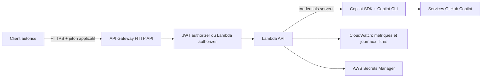
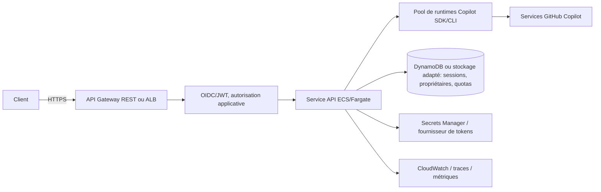
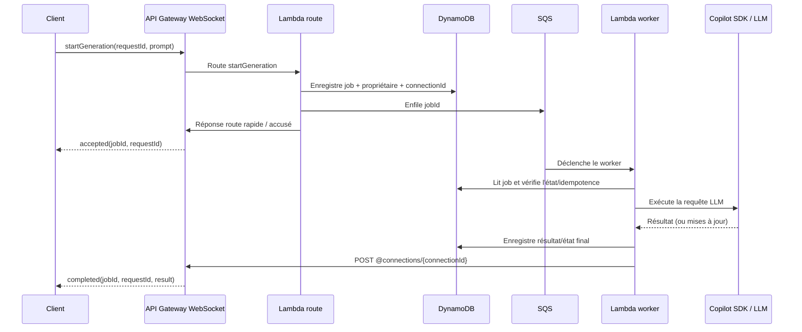

# Analyse — Gateway LLM avec API Gateway, Lambda et GitHub Copilot SDK

**Date :** 9 octobre 2026  
**Périmètre :** faisabilité d'une API AWS qui expose des endpoints d'inférence/agent et invoque des modèles via le SDK GitHub Copilot.

## Synthèse

**Oui, c'est techniquement faisable** d'exposer des routes HTTP via Amazon API Gateway, de les intégrer à AWS Lambda, puis d'appeler le GitHub Copilot SDK depuis la fonction.

Cependant, il faut distinguer deux questions :

1. **Est-ce que l'architecture AWS fonctionne ?** Oui. API Gateway sait router une requête vers Lambda et peut sécuriser l'API.
2. **Est-ce le bon moyen d'utiliser un abonnement Copilot personnel comme backend partagé ?** Pas comme hypothèse par défaut. Un token personnel utilisé par un service pour tous ses clients ferait porter l'identité, les limites et la facturation sur un compte unique. Pour un service multi-utilisateur, la documentation du SDK prévoit des identités Copilot par session ou une authentification server-to-server attribuée à une organisation. Pour BYOK, le coût est directement porté par le fournisseur de modèles.

**Recommandation :**

- Pour une **démo, un outil privé et des requêtes courtes**, API Gateway + Lambda peut convenir.
- Pour des **traitements longs sans besoin de streaming token par token**, une API Gateway WebSocket avec mise en file et worker asynchrone Lambda est une option adaptée; le client reçoit un accusé rapide puis le résultat plus tard.
- Pour une **gateway durable, multi-utilisateur ou avec streaming**, préférer API Gateway/ALB devant un service persistant sur ECS/Fargate, où le runtime du SDK peut être géré explicitement.
- Pour l'identité/billing du service, privilégier un **GitHub App installation token avec Copilot Requests** attribué à une organisation, si l'organisation et ses politiques Copilot le permettent. Si la facturation doit aller au fournisseur de modèle, utiliser le **BYOK** du SDK.
- Ne jamais placer un token GitHub ou une clé fournisseur dans le navigateur, ni exposer le token amont comme token API du client.

> Cette analyse est une recommandation technique, pas un avis juridique. Avant un lancement externe/commercial, confirmer l'usage prévu avec les conditions de l'offre Copilot concernée et les règles de facturation de l'organisation.

## Ce que fait réellement le Copilot SDK

Le [GitHub Copilot SDK](https://github.com/github/copilot-sdk) est le SDK d'intégration du **runtime agentique de Copilot CLI**. Il communique avec le processus Copilot CLI en JSON-RPC et gère des sessions, des événements, des outils et des permissions. Ce n'est pas simplement un client HTTP vers une API universelle de complétion.

Cela signifie qu'une API de gateway peut être construite au-dessus du SDK, mais il faut concevoir soi-même le contrat HTTP : formats d'entrée et de sortie, sessions, erreurs, annulation, sélection des modèles, outils autorisés et éventuellement conversion vers une forme compatible avec une API connue.

Le SDK fournit aussi BYOK pour des fournisseurs tels qu'OpenAI, Anthropic, Microsoft Foundry/Azure et des endpoints compatibles OpenAI. En BYOK, les requêtes et quotas relèvent du fournisseur configuré, et les requêtes ne consomment pas les quotas premium Copilot.

## Authentification et abonnement Copilot

### « Fournir mon token Copilot » : nuances importantes

Le SDK peut lire des credentials Copilot CLI ou accepter explicitement un token. Cela ne transforme pas automatiquement un abonnement personnel en service LLM partagé dont les clients hériteraient légitimement de l'accès. La documentation actuelle du SDK distingue plusieurs modes : connexion utilisateur, OAuth utilisateur, credentials d'environnement pour automatisation, authentification server-to-server et BYOK.

Pour un service multi-utilisateur, le guide officiel recommande des **tokens utilisateur par session** lorsqu'une requête doit être exécutée sous l'identité Copilot de la personne appelante. Il avertit de ne pas partager un token de service entre utilisateurs, sauf si le produit utilise délibérément une sémantique de compte de service.

Un autre mode documenté est l'authentification server-to-server : une GitHub App installée sur une organisation demande la permission `Copilot Requests: Read & write`; un token d'installation de courte durée est transmis au runtime via `COPILOT_GITHUB_TOKEN`. L'organisation doit autoriser cet usage, et la consommation est attribuée/facturée au compte possédant l'installation. Le token d'installation expire après une heure et doit être renouvelé. Ce mode nécessite les droits et politiques appropriés sur l'organisation.

### Impacts pratiques

- **Service personnel fermé, mono-utilisateur :** possible avec un token conservé côté serveur, en assumant l'identité et la consommation de son propre compte.
- **Service utilisé par plusieurs personnes :** préférer une authentification OAuth et un token Copilot par session, ou le mode server-to-server attribué à une organisation. Le gateway doit authentifier les appelants indépendamment de l'authentification Copilot amont.
- **Service public/commercial basé sur un abonnement individuel partagé :** ne pas présumer que c'est permis, inclus dans le forfait ou adapté à la revente. Les conditions GitHub interdisent notamment le partage de tokens API pour dépasser les limites de débit; faire valider précisément ce modèle avant de le déployer.
- **Usage server-to-server :** utiliser le mécanisme Copilot Requests documenté, pas une extraction/copie manuelle de secrets internes du CLI.
- Les modèles, crédits inclus, prix et limites varient selon le forfait et changent. L'usage SDK suit le système de comptabilisation Copilot applicable; prévoir suivi, limites et alertes.

## Architecture proposée

### Option A — prototype ou outil interne à faible volume



Flux simplifié : authentifier le client, valider le modèle et le payload, appliquer limites/quota, récupérer/renouveler les credentials nécessaires, appeler une session SDK à permissions minimales, puis renvoyer une réponse JSON.

**Limite importante :** une HTTP API a un timeout d'intégration maximal de **30 secondes**, sans augmentation. Une invocation Lambda peut durer jusqu'à 15 minutes, mais cela ne signifie pas que le client API Gateway peut attendre aussi longtemps. Pour les réponses génératives longues ou le streaming, cette combinaison HTTP API/Lambda devient vite contraignante.

### Option B — gateway de production avec streaming ou sessions



Le service garde le contrôle explicite du cycle de vie des runtimes et peut gérer la réutilisation, les sessions, les connexions longues, le streaming et la montée en charge. API Gateway REST prend en charge le streaming de réponse pour les intégrations proxy, dont Lambda proxy, avec un mode de transfert configuré à cet effet; cette option est néanmoins plus spécifique et ne résout pas à elle seule l'isolation ou la persistance du runtime Copilot. Pour une gateway orientée service, ECS/Fargate est généralement plus simple à opérer qu'un processus CLI relancé dans des invocations Lambda éphémères.

### Option C — WebSocket et traitement asynchrone pour les réponses longues

Cette option convient lorsque le traitement LLM peut dépasser le temps pendant lequel une route API Gateway peut attendre, mais que le client n'a pas besoin d'un flux token par token. **WebSocket ne supprime pas le timeout d'intégration** : pour une WebSocket API, chaque intégration (Lambda, HTTP ou AWS) a un timeout maximal de **29 secondes**. Le pattern consiste donc à accuser réception rapidement, puis à exécuter le travail hors de la requête initiale.



Flux recommandé :

1. `$connect` authentifie le client et enregistre le `connectionId` avec l'identité/tenant autorisé. Le `connectionId` est un pointeur de transport temporaire, pas une preuve d'autorisation.
2. Le client envoie un message JSON sur une route métier, par exemple `startGeneration`, avec un `requestId` idempotent et un payload borné.
3. La Lambda de route vérifie l'identité, le quota, le modèle autorisé et la taille du payload; elle crée un job persistant et place son identifiant dans SQS. Elle répond très vite, en dessous du timeout de 29 secondes. L'accusé peut être une route response configurée ou un envoi explicite par l'API Management `PostToConnection`.
4. Une Lambda worker consomme SQS, exécute le SDK/LLM, puis écrit l'état et le résultat dans DynamoDB ou un stockage adapté. Le timeout Lambda du worker peut aller jusqu'à **15 minutes**, mais ne remplace pas une orchestration durable pour les travaux qui dépassent cette durée.
5. Si la connexion d'origine est encore ouverte, le worker envoie `progress`/`completed`/`failed` avec `PostToConnection`. Si elle est fermée, le résultat reste stocké et le client peut se reconnecter puis demander `GET /v1/jobs/{jobId}` ou envoyer un message WebSocket `getJob` après vérification de propriété.

Exemple de contrat de messages :

```json
{"action":"startGeneration","requestId":"abc123","model":"modele-autorise","prompt":"..."}
{"type":"accepted","requestId":"abc123","jobId":"job-..."}
{"type":"progress","requestId":"abc123","jobId":"job-...","status":"running"}
{"type":"completed","requestId":"abc123","jobId":"job-...","result":"..."}
```

Les mises à jour de progression sont facultatives. Pour du vrai streaming token par token, il faut consommer les événements/segments du fournisseur et les retransmettre explicitement; ce n'est pas fourni automatiquement par l'architecture asynchrone. Si le client exige une réponse continue et que le SDK/runtime Copilot doit rester vivant, l'Option B sur ECS/Fargate reste à privilégier.

Limites et résilience à intégrer dès la conception :

- Une WebSocket API expire après **10 minutes d'inactivité** et après une durée maximale de connexion de **2 heures**. Envoyer des messages applicatifs périodiques pendant un travail long si nécessaire, mais ne jamais dépendre de la connexion comme stockage de l'état. Le client doit gérer reconnexion, reprise et récupération du résultat.
- Les intégrations WebSocket sont limitées à **29 secondes**; seule la première étape (authentifier, persister, mettre en file, accuser réception) doit tenir dans ce délai. L'appel LLM se fait après mise en file.
- SQS assure une livraison **au moins une fois** : le worker doit dédupliquer par `jobId`/`requestId`, enregistrer des transitions d'état conditionnelles et empêcher les générations/facturations en double. Configurer visibilité supérieure au temps normal de traitement, retries bornés, DLQ et alerte sur la DLQ.
- `PostToConnection` nécessite une permission IAM minimale `execute-api:ManageConnections`. Traiter `GoneException` comme une connexion fermée; conserver le résultat et ne pas relancer le LLM pour cette erreur.
- La taille maximale d'un message WebSocket API est **128 KB** (taille de frame maximale : **32 KB**). Pour une réponse volumineuse, stocker le résultat et envoyer un lien/référent sécurisé plutôt que multiplier les gros messages.
- Le worker Lambda ne doit pas être considéré comme un runtime Copilot persistant entre jobs. Pour les tâches dépassant 15 minutes, les sessions durables ou une orchestration avec étapes/reprise, envisager Step Functions ou ECS/Fargate plutôt que tenter de prolonger une seule invocation.
- Chiffrer et expirer les enregistrements de connexion/jobs/résultats selon les exigences de données; appliquer des quotas par tenant et une durée de conservation explicite.

## Lambda : avantages et limites dans ce cas

| Sujet | Évaluation |
|---|---|
| Mise en place d'un endpoint HTTPS | Oui, API Gateway peut intégrer Lambda en proxy. |
| Charge faible et requête sans état | Bon cas d'usage de Lambda, après test de démarrage à froid et du runtime CLI. |
| Processus Copilot CLI | Le SDK gère normalement un processus CLI. Dans Lambda, ce sous-processus et le runtime peuvent être démarrés, gelés/réutilisés ou détruits avec l'environnement d'exécution; ne pas traiter cette réutilisation comme garantie de session durable. |
| Durée | Lambda a une limite d'exécution de 15 minutes; HTTP API impose cependant un maximum d'intégration de 30 secondes. |
| WebSocket asynchrone | Une WebSocket API a un timeout d'intégration de 29 secondes. Utiliser la route uniquement pour valider, persister, mettre en file et accuser réception; exécuter le LLM dans un worker, puis notifier via `@connections`. La connexion expire après 10 minutes d'inactivité ou 2 heures. |
| Streaming | HTTP API n'est pas l'option à retenir si le client exige une sortie token par token. API Gateway REST a une option distincte de streaming de réponse; il faut valider le chemin SDK → Lambda → API Gateway bout en bout. |
| Sessions et mémoire locale | Environnements Lambda éphémères et parallélisés : les données locales ou en mémoire ne constituent pas un stockage de session fiable. Persister les sessions et vérifier leur propriétaire avant reprise. |
| Isolation multi-tenant | Le SDK recommande `mode: "empty"` en mode serveur partagé et des outils explicitement autorisés. Le mode CLI par défaut peut exposer des capacités ambiantes de l'hôte, notamment des outils système/fichiers. |
| Mise à l'échelle | API Gateway et Lambda peuvent s'échelonner, mais les limites en concurrence, quotas Copilot, appels provider et coût doivent être coordonnés. |

## Contrat d'API à définir

Commencer par un périmètre minimal et explicite, par exemple :

- `GET /health` : état de la gateway, sans révéler la configuration/secrets.
- `GET /v1/models` : modèles réellement autorisés/configurés pour cette identité et ce backend.
- `POST /v1/chat/completions` ou `POST /v1/responses` : uniquement si le besoin est une API de texte générique; définir si le format est propriétaire ou compatible avec un standard précis.
- `POST /v1/sessions` et `POST /v1/sessions/{id}/messages` : si l'on expose les sessions et capacités agentiques du SDK.

Pour la première version, limiter les modèles autorisés par une allowlist côté serveur, plafonner taille d'entrée et sortie, définir un timeout, rendre les erreurs cohérentes et ne pas accepter arbitrairement d'outils, de serveurs MCP, de répertoires ou de paramètres de runtime fournis par le client.

Si les réponses longues doivent être récupérées de façon asynchrone, définir en plus un contrat job explicite :

- WebSocket : routes `$connect`, `$disconnect`, `startGeneration`, `getJob` et, si utile, `cancelJob`; utiliser une route response ou `PostToConnection` pour l'accusé de réception.
- Chaque demande porte un `requestId` idempotent; les événements portent `jobId`, `requestId`, `status`, et éventuellement `sequence` pour détecter les doublons ou l'ordre des messages.
- Persister propriétaire/tenant, état (`queued`, `running`, `completed`, `failed`, `cancelled`), timestamps, résultat ou référence de stockage, et politique d'expiration. Ne jamais faire confiance au seul `connectionId` communiqué par le client.
- Prévoir un endpoint HTTP authentifié de repli pour consulter/récupérer le résultat après une déconnexion, même si le chemin nominal utilise WebSocket.
- Définir la sémantique d'annulation : une demande de cancellation est best-effort; vérifier si l'appel fournisseur/SDK peut réellement être interrompu et arrêter les retries/notifications même si l'amont ne sait pas annuler.

Un « endpoint compatible OpenAI » ne devrait être promis qu'après avoir vérifié la sémantique réelle : streaming SSE, fin de réponse, outils/function calling, modèles, erreurs, paramètres, identifiants et limites. Sinon, annoncer un contrat propre à l'application.

## Sécurité et exploitation minimales

1. **Authentification des clients :** OIDC/JWT (par exemple Cognito ou un IdP existant) ou Lambda authorizer. Une API key API Gateway seule sert à identifier/limiter l'usage, ce n'est pas une authentification forte.
2. **Autorisation et quotas :** quotas par principal, throttling, limites de taille, durée, concurrence et crédits; protections anti-abus et mécanisme d'arrêt d'urgence.
3. **Secrets amont :** AWS Secrets Manager avec un rôle IAM minimal et rotation/renouvellement. Ne jamais renvoyer ni journaliser un token Copilot, GitHub ou fournisseur.
4. **Sessions et jobs :** identifiants non prédictibles; rattacher chaque session/job à un utilisateur/tenant côté serveur et contrôler l'accès avant toute reprise, lecture, annulation ou suppression. Pour WebSocket, le `connectionId` n'est ni l'identité ni la source de vérité de l'état.
5. **Outils :** `mode: "empty"` pour serveur multi-utilisateur; activer uniquement les outils nécessaires. Ne pas autoriser par défaut l'accès shell, fichiers, MCP ou réseau général.
6. **Données :** ne pas journaliser les prompts/réponses sensibles par défaut; configurer rétention, chiffrement, accès CloudWatch et règles de redaction. Informer les appelants du traitement amont.
7. **Résilience :** délais, annulation, retries bornés avec backoff, déduplication/idempotence si nécessaire, gestion des erreurs de quotas et des réponses partielles. Pour le chemin SQS : tenir compte de la livraison au moins une fois, régler visibilité/retries/DLQ, persister l'état avant notification et ne pas retraiter le LLM après un simple échec `GoneException` de `PostToConnection`.
8. **Observabilité :** métriques de latence, temps avant premier token, erreurs, consommation/quota par tenant sans enregistrer de contenu sensible.
9. **Réseau :** accès sortant requis vers les services GitHub ou fournisseurs de modèles; si Lambda est dans un VPC privé, prévoir l'egress nécessaire (NAT ou architecture équivalente).

## Décision recommandée selon le besoin

| Besoin | Choix recommandé |
|---|---|
| Tester le SDK depuis un endpoint privé, appels courts, aucune session durable | API Gateway HTTP API + Lambda; commencer avec une authentification forte et un faible quota. |
| Réponses longues sans streaming token par token, notification quand le résultat est prêt | API Gateway WebSocket pour soumission/notifications + Lambda route rapide + SQS + Lambda worker + DynamoDB pour jobs/connexions/résultats; endpoint HTTP de reprise recommandé. Vérifier la compatibilité et le cycle de vie du runtime Copilot CLI dans Lambda. |
| Exposer une API interne à une équipe avec consommation portée par l'organisation | GitHub App server-to-server/Copilot Requests si disponible et autorisé; considérer un service ECS/Fargate dès qu'il y a sessions ou streaming. |
| Chaque utilisateur consomme son propre accès Copilot | OAuth GitHub par utilisateur, tokens/scopes par session conformément au guide SDK; gateway applicative multi-tenant. |
| Exposer une API LLM commerciale ou maîtriser précisément coût, quotas et disponibilité | BYOK avec comptes/projets fournisseur dédiés; gateway et quotas applicatifs; choisir Lambda ou ECS selon latence/streaming. |
| Réponses longues/token streaming ou runtime persistant | ECS/Fargate derrière API Gateway REST en streaming ou ALB, avec tests de bout en bout et état de session externe. |

## Plan de validation avant implémentation

1. Décider si le service est mono-utilisateur, interne multi-utilisateur, ou offert à des tiers; préciser qui paie et sous quelle identité.
2. Vérifier le type d'abonnement et les politiques GitHub Copilot applicables. Pour une organisation, confirmer Copilot Requests, les droits GitHub App et l'attribution de facturation.
3. Choisir entre authentification Copilot utilisateur, GitHub App server-to-server, ou BYOK; ne pas partir d'un token personnel partagé sans validation.
4. Prototyper un appel SDK dans Lambda et mesurer cold start, taille d'artefact, durée, mémoire et concurrence. Vérifier que le runtime CLI est compatible avec l'environnement Lambda choisi.
5. Tester le vrai contrat API Gateway avec la latence réelle des modèles; choisir entre réponse synchrone, job asynchrone WebSocket ou streaming de bout en bout.
6. Pour le prototype WebSocket : valider `$connect`/authentification, accusé de réception sous 29 secondes, enfilage SQS, traitement LLM, callback `PostToConnection`, messages d'erreur et reprise du résultat après déconnexion.
7. Tester les doublons SQS et les retries sans double génération, DLQ et alerte, `GoneException`, reconnexion/récupération, expiration à 10 minutes/2 heures, taille de message, quotas par tenant, annulation et nettoyage TTL des jobs/connexions.
8. Tester isolation multi-tenant, refus de modèle non autorisé, expiration/rotation de token, dépassement de quota et absence de fuite dans les logs.
9. Chiffrer le coût complet : API Gateway (connexions et messages WebSocket), Lambda route/worker et concurrence, SQS, DynamoDB/stockage des résultats, journaux/traces, egress/NAT éventuel, et crédits Copilot ou facture provider. Comparer au polling HTTP et à ECS/Fargate selon le volume et la durée des connexions.

## Sources officielles consultées

### GitHub

- [GitHub Copilot SDK — dépôt et présentation](https://github.com/github/copilot-sdk)
- [Guide d'authentification du SDK](https://github.com/github/copilot-sdk/blob/main/docs/auth/authenticate.md)
- [Authentification server-to-server et Copilot Requests](https://github.com/github/copilot-sdk/blob/main/docs/auth/server-to-server-tokens.md)
- [Multi-tenancy et déploiements serveur](https://github.com/github/copilot-sdk/blob/main/docs/setup/multi-tenancy.md)
- [BYOK avec le Copilot SDK](https://github.com/github/copilot-sdk/blob/main/docs/auth/byok.md)
- [Tarification, crédits IA et modèles Copilot](https://docs.github.com/en/copilot/reference/copilot-billing/models-and-pricing)
- [Conditions GitHub — API Terms et AI Features](https://docs.github.com/en/site-policy/github-terms/github-terms-of-service)
- [Conditions additionnelles GitHub — GitHub Copilot](https://docs.github.com/en/site-policy/github-terms/github-terms-for-additional-products-and-features)

### AWS

- [API Gateway HTTP APIs](https://docs.aws.amazon.com/apigateway/latest/developerguide/http-api.html)
- [Quotas HTTP API — timeout d'intégration](https://docs.aws.amazon.com/apigateway/latest/developerguide/http-api-quotas.html)
- [Streaming de réponse API Gateway](https://docs.aws.amazon.com/apigateway/latest/developerguide/response-transfer-mode.html)
- [Quotas AWS Lambda — durée maximale et payloads](https://docs.aws.amazon.com/lambda/latest/dg/gettingstarted-limits.html)
- [Lambda authorizers pour HTTP API](https://docs.aws.amazon.com/apigateway/latest/developerguide/http-api-lambda-authorizer.html)
- [Vue d'ensemble des API WebSocket API Gateway et de leurs routes](https://docs.aws.amazon.com/apigateway/latest/developerguide/apigateway-websocket-api-overview.html)
- [Quotas WebSocket API Gateway — timeout 29 s, payload, inactivité et durée des connexions](https://docs.aws.amazon.com/apigateway/latest/developerguide/apigateway-execution-service-websocket-limits-table.html)
- [Envoyer des messages à une connexion avec l'API de gestion `@connections`](https://docs.aws.amazon.com/apigateway/latest/developerguide/apigateway-how-to-call-websocket-api-connections.html)
- [Invocation asynchrone de Lambda](https://docs.aws.amazon.com/lambda/latest/dg/invocation-async.html)
- [Files de messages Amazon SQS](https://docs.aws.amazon.com/AWSSimpleQueueService/latest/SQSDeveloperGuide/welcome.html)
- [Files SQS de lettres mortes](https://docs.aws.amazon.com/AWSSimpleQueueService/latest/SQSDeveloperGuide/sqs-dead-letter-queues.html)

---

**Conclusion :** l'assemblage API Gateway → Lambda → Copilot SDK est réalisable, mais le point décisif n'est pas la connectivité AWS : c'est l'identité et la facturation Copilot, puis la gestion du runtime CLI, des durées et des sessions. Pour un prototype privé, Lambda est plausible. Pour des traitements longs sans streaming token par token, l'option WebSocket + SQS + worker Lambda permet de rendre la requête initiale courte et de notifier plus tard, à condition de rendre les jobs persistants, idempotents et récupérables après déconnexion. Pour une véritable gateway partagée, privilégier un compte de service Copilot explicitement autorisé ou BYOK, et un runtime persistant ECS/Fargate lorsque le streaming, les sessions durables ou des traitements dépassant 15 minutes sont requis.
