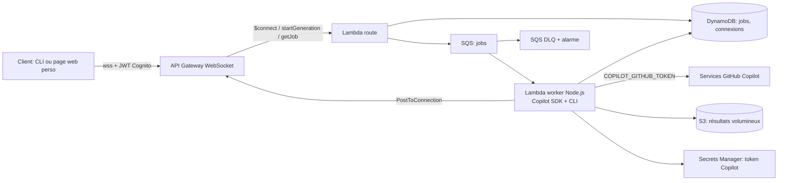
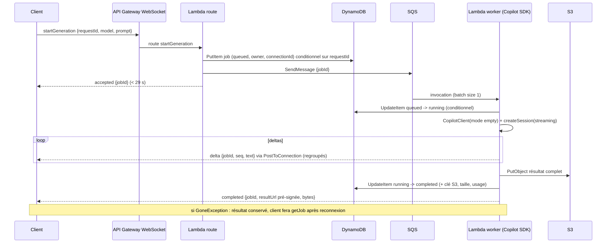

# Analyse — Gateway LLM personnelle sur AWS avec le GitHub Copilot SDK

**Date :** 9 octobre 2026  
**Périmètre :** API personnelle hébergée sur AWS qui exécute des requêtes via le GitHub Copilot SDK, pour des réponses potentiellement longues (plusieurs minutes) et volumineuses (plusieurs centaines de Ko à plusieurs Mo).  
**Version précédente :** [ANALYSE_v1_generique.md](ANALYSE_v1_generique.md) (analyse générique multi-options, conservée pour référence).

## Contraintes de départ

| Contrainte | Conséquence sur la conception |
|---|---|
| Projet personnel, un seul utilisateur (moi) | Pas de multi-tenant, pas de facturation tierce; authentification forte mais simple; coût proche de zéro au repos. |
| **Copilot SDK non négociable** (seule licence disponible) | Le runtime Copilot CLI doit tourner côté serveur. Pas de BYOK ni de fournisseur direct. Le token est le mien et reste sur le serveur. |
| Réponses longues (au-delà de 30 s, parfois plusieurs minutes) | Aucune route API Gateway ne peut attendre : il faut découpler la demande du traitement. |
| Réponses volumineuses | Les messages WebSocket sont limités à 128 Ko : le résultat complet doit vivre dans S3, pas dans le message. |
| Pas de dépendance à un poste allumé | Le runtime Copilot CLI doit démarrer dans AWS (Lambda ou conteneur), pas sur ma machine. |

## Synthèse

**Architecture retenue :** API Gateway WebSocket pour soumettre les demandes et recevoir les notifications, une Lambda de route qui accuse réception en moins de 29 s, une file SQS, une **Lambda worker Node.js qui embarque le Copilot SDK et son CLI**, DynamoDB pour l'état des jobs et S3 pour les résultats volumineux. Le client reçoit les deltas de texte en quasi temps réel s'il est connecté, et récupère le résultat complet via une URL S3 pré-signée quand le job est terminé — même après une déconnexion.

**Point de vigilance numéro un :** le Copilot SDK pilote un processus Copilot CLI en JSON-RPC. Faire tourner ce sous-processus dans Lambda est faisable sur le papier (Node.js, CLI bundlé, `/tmp` inscriptible, 15 min max) mais c'est l'hypothèse à valider en premier, avant d'écrire une seule ligne d'infrastructure WebSocket. Le plan B est un conteneur ECS Fargate pour le worker, avec exactement le même contrat SQS/DynamoDB/S3.

**Identité et licence :** usage strictement personnel, sous ma propre identité Copilot, pour mes propres requêtes. Le token Copilot n'est jamais exposé au client, jamais journalisé, et l'API n'est ouverte à personne d'autre. Cette analyse n'est pas un avis juridique : c'est l'usage prévu par le mode « environment variables / automation » du SDK, qui compte chaque prompt sur mon quota Copilot.

## Ce que fait réellement le Copilot SDK (et ce que ça impose)

Le [Copilot SDK](https://github.com/github/copilot-sdk) n'est pas un client HTTP vers une API de complétion. C'est un client JSON-RPC vers le **Copilot CLI en mode serveur**. Le SDK Node.js embarque le CLI et gère son cycle de vie (spawn, arrêt). Conséquences concrètes :

- **Runtime :** Node.js (le SDK Node.js/TypeScript bundle le CLI; pas d'installation séparée). Lambda Node.js 20+ convient a priori.
- **Processus enfant :** chaque `CopilotClient` lance un processus CLI. Dans Lambda, ce processus vit dans l'environnement d'exécution; il est gelé entre deux invocations et détruit avec l'environnement. Il faut `client.stop()` en fin de traitement et ne jamais supposer qu'une session survit d'un job à l'autre.
- **Stockage local :** le runtime écrit son état sous `COPILOT_HOME` (`session-state/{sessionId}`). Dans Lambda, pointer `baseDirectory` vers `/tmp` (512 Mo par défaut, extensible à 10 Go) ou router via `sessionFs`.
- **Mode :** `mode: "empty"` même pour un usage mono-utilisateur. Le mode par défaut `copilot-cli` expose des outils ambiants (shell, fichiers) du conteneur Lambda; inutile et risqué pour une API texte.
- **Streaming :** `createSession({ streaming: true })` puis `session.on("assistant.message_delta", ...)` fournit les deltas; `session.idle` signale la fin. C'est ce qui permet de pousser du quasi temps réel vers le client WebSocket.
- **Authentification :** `COPILOT_GITHUB_TOKEN` lu automatiquement. Tokens acceptés : `gho_`, `ghu_`, `github_pat_` (fine-grained). Les PAT classiques `ghp_` ne sont pas supportés. `useLoggedInUser: false` pour interdire tout repli sur des credentials ambiants.
- **Facturation :** chaque prompt compte sur mon quota Copilot comme un prompt CLI. Prévoir un plafond de jobs par jour côté API pour éviter de vider le quota par erreur (boucle client, retry SQS).

## Pourquoi pas une simple HTTP API ou du streaming direct

| Approche | Verdict pour ce projet |
|---|---|
| API Gateway HTTP API → Lambda synchrone | Timeout d'intégration de **30 s**, non augmentable. Inadapté aux réponses de plusieurs minutes. |
| API Gateway REST avec streaming de réponse | Possible, mais ne résout ni la reprise après coupure, ni le stockage des gros résultats; plus complexe à sécuriser qu'une Function URL pour un usage perso. |
| Lambda Function URL + response streaming (Node.js) | **Alternative la plus simple pour un v0 de test** : jusqu'à 15 min, 200 Mo streamés, auth IAM (SigV4) native. Limites : la connexion doit rester ouverte tout le long, pas de reprise si elle coupe, facturation jusqu'au bout même si le client part, auth IAM peu pratique depuis un navigateur. Bon pour valider le SDK dans Lambda, pas comme produit final. |
| **API Gateway WebSocket + SQS + worker** | Retenu : accusé rapide, traitement long découplé, deltas en temps réel si connecté, résultat durable et récupérable, coût nul au repos. |

## Architecture cible



### Déroulé d'un job



### Composants et réglages

**API Gateway WebSocket**
- Routes : `$connect` (auth), `$disconnect` (nettoyage), `startGeneration`, `getJob`, `cancelJob`, `ping`, `$default` (rejet).
- Timeout d'intégration maximal **29 s** : la route ne fait que valider, persister, enfiler, répondre.
- Connexion fermée après **10 min d'inactivité** ou **2 h** au total. Le client envoie un `ping` applicatif toutes les 5 min pendant un job long, et sait se reconnecter puis appeler `getJob`.
- Message max **128 Ko**, frame **32 Ko** : les deltas sont petits, le résultat complet passe par S3.
- Authentification sur `$connect` : Lambda authorizer qui valide un JWT Cognito (user pool avec un seul utilisateur, MFA activée) passé en query string ou header. Les routes suivantes font confiance au `connectionId` uniquement parce que `$connect` l'a associé à mon identité dans DynamoDB.

**Lambda route** (Node.js, 256 Mo, timeout 10 s)
- Valide : taille du prompt (plafond, ex. 200 Ko), modèle dans une allowlist, quota journalier (compteur DynamoDB), `requestId` idempotent.
- `PutItem` conditionnel (`attribute_not_exists(pk)`) : un même `requestId` renvoie le job existant au lieu d'en créer un second.

**SQS**
- File standard, `batchSize: 1` sur l'event source mapping (un job = une invocation).
- Visibility timeout ≥ **6 × timeout du worker** (recommandation AWS pour Lambda) : worker à 15 min → visibilité 90 min.
- `maxReceiveCount: 2` puis DLQ. Chaque retry consomme du quota Copilot : ne pas retenter indéfiniment. Alarme CloudWatch sur `ApproximateNumberOfMessagesVisible` de la DLQ.
- Concurrence réservée du worker : 1 ou 2. Protège le quota Copilot et évite des cold starts parallèles coûteux.

**Lambda worker** (Node.js, 2 048 Mo pour ~1 vCPU et un démarrage CLI rapide, timeout 900 s, `/tmp` 1 Go)
- Package : fonction conteneur (image jusqu'à 10 Go) plutôt que zip si le SDK + CLI dépasse 250 Mo décompressés. À mesurer.
- Par invocation : lire le token depuis Secrets Manager (mis en cache en mémoire), `new CopilotClient({ mode: "empty", baseDirectory: "/tmp/copilot", useLoggedInUser: false, sessionIdleTimeoutSeconds: 600 })`, `createSession({ model, streaming: true })`, `sendAndWait`, puis `client.stop()` dans un `finally`.
- Transition d'état conditionnelle `queued → running` : si elle échoue, le message est un doublon SQS → sortir sans appeler Copilot.
- Deltas : accumuler et envoyer un `PostToConnection` toutes les ~400 ms ou tous les ~2 Ko, numéroté `seq`. Chaque message WebSocket est facturé : regrouper évite des milliers d'appels par réponse.
- `GoneException` sur `PostToConnection` : marquer la connexion comme perdue, continuer le job, ne plus notifier. Le résultat sera récupéré via `getJob`.
- Garde-fou temps : si `context.getRemainingTimeInMillis()` passe sous ~60 s, arrêter proprement la session, stocker le texte partiel dans S3 avec `status: "truncated"` et notifier. Mieux qu'un timeout Lambda brutal qui laisserait le job en `running`.
- Résultat : `PutObject` dans S3 (`results/{jobId}.md` ou `.json`), SSE-S3 ou KMS, lifecycle 30 jours. URL pré-signée de 15 min renvoyée dans `completed` et régénérée à chaque `getJob`.

**DynamoDB**
- Table `jobs` : `pk = jobId`, attributs `requestId` (GSI), `owner`, `status` (`queued|running|completed|failed|truncated|cancelled`), `connectionId`, `createdAt`, `updatedAt`, `s3Key`, `bytes`, `error`, `ttl` (30 jours).
- Table `connections` : `pk = connectionId`, `owner`, `connectedAt`, `ttl` (3 h, la connexion ne dure jamais plus de 2 h).
- Compteur `quota#YYYY-MM-DD` pour le plafond quotidien.

### Contrat de messages

```json
// client -> serveur
{"action":"startGeneration","requestId":"7f3a…","model":"gpt-5.4","prompt":"…"}
{"action":"getJob","jobId":"job_01J…"}
{"action":"cancelJob","jobId":"job_01J…"}
{"action":"ping"}

// serveur -> client
{"type":"accepted","requestId":"7f3a…","jobId":"job_01J…"}
{"type":"delta","jobId":"job_01J…","seq":12,"text":"…"}
{"type":"completed","jobId":"job_01J…","bytes":348211,"resultUrl":"https://…(pré-signée, 15 min)"}
{"type":"job","jobId":"job_01J…","status":"running","bytesSoFar":120000}
{"type":"failed","jobId":"job_01J…","error":"model_not_allowed|quota_exceeded|upstream_error|timeout"}
{"type":"pong"}
```

`cancelJob` est best-effort : il passe le job en `cancelled` dans DynamoDB; le worker vérifie ce flag entre deux lots de deltas et arrête la session. Si le worker a déjà terminé, l'annulation est ignorée.

## Sécurité minimale (même pour un projet perso)

1. **Token Copilot** dans Secrets Manager, lu par le worker uniquement (`secretsmanager:GetSecretValue` sur cet ARN). Jamais dans une variable d'environnement Lambda en clair, jamais dans les logs, jamais renvoyé au client. Rotation manuelle documentée (révoquer l'ancien PAT après remplacement).
2. **Authentification client** : Cognito user pool, un compte, MFA. JWT vérifié par un Lambda authorizer sur `$connect`. Pas d'API key API Gateway seule.
3. **IAM par fonction** : route → `dynamodb:PutItem/GetItem/UpdateItem` + `sqs:SendMessage`; worker → `sqs:ReceiveMessage/DeleteMessage`, `dynamodb:UpdateItem/GetItem`, `s3:PutObject/GetObject` sur le préfixe `results/`, `execute-api:ManageConnections` sur l'API, `secretsmanager:GetSecretValue` sur le secret.
4. **Copilot SDK** : `mode: "empty"`, aucun outil, aucun MCP, aucun répertoire de travail exposé. Le worker ne doit pas pouvoir devenir un agent qui exécute des commandes dans Lambda.
5. **Données** : S3 chiffré, bucket privé, URLs pré-signées courtes, TTL DynamoDB, lifecycle S3. Pas de prompts ni de réponses dans CloudWatch (log uniquement `jobId`, durées, tailles, codes d'erreur).
6. **Garde-fous de coût/quota** : plafond de jobs par jour, concurrence réservée faible, alarme DLQ, alarme sur la durée moyenne du worker et sur `Throttles`.
7. **Réseau** : worker hors VPC (egress Internet direct vers GitHub sans NAT). Rien à joindre dans un VPC privé.

## Plan B si le CLI ne tient pas dans Lambda

Symptômes possibles : binaire incompatible avec l'environnement Lambda, cold start de plusieurs dizaines de secondes, besoin d'écrire hors `/tmp`, processus tué au gel de l'environnement, sessions dépassant 15 min.

Remplacer **uniquement le worker** par une tâche ECS Fargate (0,5 vCPU / 1 Go) qui consomme la même file SQS, avec le même contrat DynamoDB/S3/`PostToConnection`. Démarrer la tâche à la demande (règle EventBridge sur la métrique SQS ou `RunTask` depuis la Lambda route) et l'arrêter quand la file est vide, pour garder un coût nul au repos. La route, l'API WebSocket et le client ne changent pas.

Variante intermédiaire : Lambda Managed Instances permet des invocations asynchrones jusqu'à 90 min; à considérer seulement si le blocage est la durée et non la compatibilité du CLI.

## Ordre de grandeur des coûts (usage perso, faible volume)

- Au repos : 0 € (aucune ressource facturée à l'heure, hors éventuel secret Secrets Manager ≈ 0,40 €/mois).
- Par job de 5 min à 2 Go : Lambda ≈ 600 Go-s ≈ 0,01 €; quelques dizaines de messages WebSocket et minutes de connexion : fractions de centime; S3/DynamoDB : négligeable.
- Le vrai coût est le **quota Copilot** : chaque job = un prompt sur mon abonnement. D'où le plafond journalier et le `maxReceiveCount` bas.

## Plan de validation, dans l'ordre

1. **Prouver le SDK dans Lambda** (avant tout le reste) : une Lambda Node.js minimale avec `@github/copilot-sdk`, `mode: "empty"`, token via Secrets Manager, un prompt court. Mesurer : taille du package (zip vs image), durée du cold start, mémoire, temps de spawn du CLI, bon fonctionnement de `client.stop()`. Tester un prompt long (plusieurs minutes) et vérifier que le streaming de deltas fonctionne jusqu'au bout.
2. **Valider l'arrêt propre** : simuler l'approche du timeout et vérifier qu'on stocke un résultat partiel plutôt que de perdre le job.
3. **Déployer le chemin asynchrone** : route → SQS → worker → S3 → DynamoDB, sans WebSocket, en déclenchant par la console. Vérifier idempotence (`requestId` dupliqué), doublon SQS (pas de second appel Copilot), DLQ.
4. **Ajouter WebSocket** : `$connect` + authorizer, `startGeneration`, deltas regroupés, `completed` avec URL pré-signée, `GoneException`, reprise via `getJob` après reconnexion, expiration 10 min/2 h.
5. **Résultats volumineux** : job produisant plusieurs Mo; vérifier taille des messages, upload S3, téléchargement via URL pré-signée, TTL/lifecycle.
6. **Garde-fous** : quota journalier atteint, modèle non autorisé, token expiré/révoqué (erreur claire, pas de retry infini), annulation.
7. **Client** : un petit script CLI (Node.js) qui se connecte, envoie un prompt, affiche les deltas, télécharge le résultat; puis, si utile, une page web statique sur S3 avec Cognito Hosted UI.

## Sources officielles consultées

### GitHub Copilot SDK

- [Dépôt, architecture JSON-RPC, CLI bundlé, FAQ facturation](https://github.com/github/copilot-sdk)
- [Getting started — streaming `assistant.message_delta`, mode serveur externe](https://github.com/github/copilot-sdk/blob/main/docs/getting-started.md)
- [Authentification — variables d'environnement, types de tokens, priorité](https://github.com/github/copilot-sdk/blob/main/docs/auth/authenticate.md)
- [Déploiements serveur — `mode: "empty"`, `baseDirectory`, `sessionFs`, `sessionIdleTimeoutSeconds`](https://github.com/github/copilot-sdk/blob/main/docs/setup/multi-tenancy.md)
- [Tarification et comptabilisation des requêtes Copilot](https://docs.github.com/en/copilot/reference/copilot-billing/models-and-pricing)

### AWS

- [API WebSocket API Gateway — routes et envoi de données](https://docs.aws.amazon.com/apigateway/latest/developerguide/apigateway-websocket-api-overview.html)
- [Quotas WebSocket — 29 s, 128 Ko/32 Ko, 10 min, 2 h](https://docs.aws.amazon.com/apigateway/latest/developerguide/apigateway-execution-service-websocket-limits-table.html)
- [`@connections` / PostToConnection](https://docs.aws.amazon.com/apigateway/latest/developerguide/apigateway-how-to-call-websocket-api-connections.html)
- [Quotas HTTP API — 30 s](https://docs.aws.amazon.com/apigateway/latest/developerguide/http-api-quotas.html)
- [Quotas Lambda — 15 min, 250 Mo zip / 10 Go image, /tmp, payloads](https://docs.aws.amazon.com/lambda/latest/dg/gettingstarted-limits.html)
- [Lambda response streaming — Function URL, 200 Mo, Node.js](https://docs.aws.amazon.com/lambda/latest/dg/configuration-response-streaming.html)
- [Lambda + SQS — event source mapping et visibility timeout](https://docs.aws.amazon.com/lambda/latest/dg/with-sqs.html)
- [SQS — files de lettres mortes](https://docs.aws.amazon.com/AWSSimpleQueueService/latest/SQSDeveloperGuide/sqs-dead-letter-queues.html)

---

**Conclusion :** avec le Copilot SDK imposé et des réponses longues et lourdes, la bonne forme est un pipeline asynchrone — WebSocket pour l'interactivité, SQS pour le découplage, un worker qui héberge le runtime Copilot, S3 pour les résultats, DynamoDB pour l'état. Le seul inconnu structurant est le comportement du Copilot CLI dans Lambda : c'est la première chose à prototyper, et le plan B Fargate ne change rien au reste de l'architecture.
